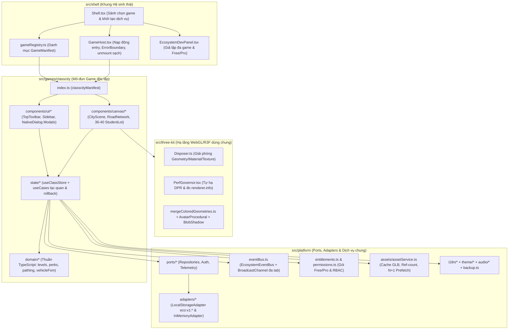

# ClassCity Edu Ecosystem — ClassCity 3D

Hệ sinh thái trò chơi giáo dục quản lý lớp học thông minh định hướng SaaS đa trò chơi, khởi đầu với **ClassCity 3D** — nơi mỗi học sinh làm chủ một cửa hàng 3D phát triển qua **20 cấp độ kiến trúc**, có nhân vật đại diện đi dạo trên vỉa hè, xe tuần tra **Auto Lái Gọi Tên** trả bài, hộp quà đặc quyền và **Kỳ Quan Lớp Học** chung của tập thể.

---

## 1. Yêu cầu môi trường & Cách chạy (Windows PowerShell)

> **Lưu ý trên Windows PowerShell:** Luôn gọi `npm.cmd` (không đổi Execution Policy). Môi trường không dùng `npx.cmd` — thay `npx <gói> ...` bằng `npm.cmd exec --yes -- <gói> ...`.

```powershell
# 1. Cài đặt phụ thuộc
npm.cmd install

# 2. Chạy máy chủ phát triển (tự mở tại http://localhost:5173/)
npm.cmd run dev

# 3. Chạy cổng kiểm định toàn diện (TypeScript + Oxlint + Ranh giới kiến trúc + Vitest)
npm.cmd run verify

# 4. Đóng gói bản sản phẩm (tách chunk động theo GameManifest & Modal)
npm.cmd run build

# 5. Xem thử bản đóng gói sản phẩm (thêm ?dev=1 trên URL nếu muốn bật Bảng Dev Hệ sinh thái)
npm.cmd run preview
```

### Đẩy kho Git cục bộ lên GitHub / GitLab của bạn
Dự án đã lưu sẵn lịch sử commit cục bộ theo từng giai đoạn (`GĐ0 → GĐ8`) ngay trong thư mục `.git` trên máy và **chưa gắn bất kỳ remote nào**. Khi bạn muốn đưa mã nguồn lên GitHub/GitLab:

```powershell
git remote add origin https://github.com/<tai-khoan>/<ten-repo>.git
git push -u origin master
```

---

## 2. Sơ đồ kiến trúc tổng thể

Dự án tuân thủ kiến trúc **Modular Client + Ports & Adapters** (`docs/02-system-architecture.md` & `docs/03-agent-build-brief.md`), tách bạch hoàn toàn phần khung hệ sinh thái (`shell`), nền tảng dùng chung (`platform`), bộ công cụ 3D (`three-kit`) và từng trò chơi độc lập (`games/<gameId>`).



### Cấu trúc thư mục chính

```text
ClassCity-Ecosystem/
├── public/
│   ├── fonts/                       # Font Be Vietnam Pro (.woff2) tự lưu trữ hỗ trợ đầy đủ tiếng Việt
│   ├── shared-assets/models/        # Nơi đặt mô hình .glb nhân vật dùng chung toàn hệ sinh thái
│   └── games/classcity/models/      # Nơi đặt mô hình .glb cửa hàng, xe tuần tra, Kỳ Quan của ClassCity
├── scripts/
│   └── check-boundaries.mjs         # Kiểm tra tự động quy tắc R1–R10 & ranh giới import giữa các tầng
├── src/
│   ├── lib/cn.ts                    # Hàm ghép class gọn nhẹ tự viết
│   ├── platform/                    # Types, Ports, LocalStorage/InMemory Adapters, EventBus, Entitlements, Assets, Backup
│   ├── three-kit/                   # Disposer, PerfGovernor, BlobShadow, AvatarProcedural, mergeColoredGeometries
│   ├── shell/                       # Shell, GameHost, gameRegistry, EcosystemDevPanel
│   └── games/classcity/             # Domain thuần TS, Zustand store + useCases, Cảnh 3D R3F & Giao diện HUD 2D
├── docs/                            # Đặc tả tính năng, kiến trúc, brief thi công, design-plan.md, LICENSES.md
├── DESIGN.md                        # Tài liệu hệ thống thiết kế trích xuất chuẩn @google/design.md
└── .agents/skills/                  # Bộ AI skills quản trị chất lượng dự án
```

---

## 3. Cách thêm một game mới trong 10 bước

Nhờ hợp đồng `GameManifest` và `GameContext`, bạn có thể bổ sung trò chơi mới (ví dụ `classfarm` hoặc `classarena`) dùng chung danh sách học sinh, nhân vật 3D và sổ cái điểm với ClassCity mà **không sửa code của ClassCity**:

1. **Khai báo mã định danh (nếu chưa có):** Kiểm tra kiểu `GameId` trong `src/platform/types/models.ts` (đã mở sẵn `'classcity' | 'classfarm' | 'classarena' | 'classquest'`).
2. **Tạo thư mục cô lập:** Tạo `src/games/<gameId>/` gồm `domain/`, `state/`, `components/`, `locales/` và `index.ts`.
3. **Viết logic nghiệp vụ thuần TS (`domain/`):** Đặt công thức tính toán tại `src/games/<gameId>/domain/` — không import `react`, `three`, `zustand` hay `gsap` (quy tắc `R3`).
4. **Khai báo từ điển đa ngôn ngữ (`locales/`):** Tạo `vi.ts` và `en.ts`, đăng ký với `registerMessages('vi', ...)` / `registerMessages('en', ...)` khi nạp mô-đun (quy tắc `R8`).
5. **Đọc/ghi dữ liệu qua `ctx.repos` & sổ cái bất biến:** Trong `useCases`, cộng/trừ điểm qua `ctx.repos.ledger.award({ studentId, classroomId, gameId: '<gameId>', delta, reason, idempotencyKey, actorUserId })` và lưu trạng thái riêng của game qua `ctx.repos.gameStates` (quy tắc `R1`, `R2`).
6. **Phát và lắng nghe `EcoEvent`:** Sau khi `ledger.award` thành công, phát `ctx.bus.publish('LEDGER:POINTS_AWARDED', { tx, totalPoints }, { gameId: '<gameId>', classroomId })` để mọi tab/game khác cập nhật tức thì; luôn lưu hàm hủy đăng ký `unsub()` để gọi khi unmount (quy tắc `R5`, `R10`).
7. **Kiểm tra gói thuê bao & phân quyền qua dịch vụ tập trung:** Dùng `ctx.entitlements.has(...)` và `ctx.permissions.can(...)`, tuyệt đối không tự so sánh chuỗi gói thuê bao trong game (quy tắc `R7`).
8. **Viết `GameManifest` với `entry()` nạp động:** Trong `src/games/<gameId>/index.ts`, xuất `<gameId>Manifest` có `entry: async () => ({ mount(el, ctx) { ... return { onContextChange, unmount }; } })` để Vite tự tách chunk riêng.
9. **Đăng ký vào `gameRegistry.ts`:** Thêm `<gameId>Manifest` vào mảng `gameRegistry` trong `src/shell/gameRegistry.ts` (và gỡ khỏi danh sách `upcomingGames` nếu có). Khi `gameRegistry.length > 1`, `Shell` tự hiển thị Sảnh chọn game khi khởi động.
10. **Chạy kiểm định tự động:** Chạy `npm.cmd run verify` để `scripts/check-boundaries.mjs` xác nhận game mới không vi phạm ranh giới kiến trúc và vượt qua toàn bộ unit test.

---

## 4. Cách thay Adapter lưu trữ sang Backend REST / Spring Boot

Toàn bộ giao diện và logic game chỉ giao tiếp với dữ liệu qua giao diện `Repositories` (`src/platform/ports/repositories.ts`). Khi sẵn sàng kết nối Backend Java Spring Boot:

1. Tạo thư mục `src/platform/adapters/http/` triển khai các cổng trong `src/platform/ports/repositories.ts` (`ClassroomRepo`, `StudentRepo`, `LedgerRepo`, `GameStateRepo`, `SettingsRepo`, `TeacherRepo`) gọi REST API kèm header `X-Tenant-Id` và `Idempotency-Key`.
2. Khởi tạo bộ repo HTTP trong `src/shell/Shell.tsx` thay cho `createRepositories(createBrowserAdapter(...))`.
3. Chạy lại cùng bộ **Contract Tests** trong `src/platform/__tests__/platform.contract.test.ts` đối chiếu với adapter mới để đảm bảo tính bất biến của sổ cái, chống cộng trùng (`idempotencyKey`) và kiểm soát xung đột phiên bản (`rev`).

---

## 5. Cách thêm Gói thuê bao / Tính năng & Phân quyền

- **Thêm tính năng thương mại hóa (Feature Gate):**
  1. Bổ sung khóa `Feature` mới (ví dụ `'classfarm.greenhouse'`) vào `src/platform/types/models.ts`.
  2. Cập nhật bảng ánh xạ `TIER_FEATURES` cho từng gói (`free`, `pro`, `school`) trong `src/platform/entitlements/entitlements.ts`.
  3. Kiểm tra trong UI/useCases bằng `ctx.entitlements.has('classfarm.greenhouse')`.
- **Thêm vai trò hoặc quyền thao tác (RBAC):**
  1. Bổ sung quyền `Permission` vào `src/platform/types/models.ts`.
  2. Cập nhật ma trận vai trò (`teacher`, `assistant`, `student_viewer`, `school_admin`) trong `src/platform/permissions/permissions.ts`.

---

## 6. Cách thêm Ngôn ngữ mới

1. Mở rộng kiểu `Locale` trong `src/platform/i18n/index.ts` (ví dụ `'vi' | 'en' | 'ja'`).
2. Tạo file từ điển nền tảng `src/platform/i18n/locales/ja.ts` và đăng ký mặc định trong `src/platform/i18n/index.ts`.
3. Tạo file từ điển riêng cho từng game `src/games/classcity/locales/ja.ts` và gọi `registerMessages('ja', classCityJa)` trong `ClassCityModule.tsx`.
4. Thêm lựa chọn ngôn ngữ mới trong `SettingsModal.tsx` và `Shell.tsx`.

---

## 7. Cách thêm hoặc thay thế Mô hình 3D `.glb` thật

Hiện tại dự án tự động dựng hình 3D thủ tục (`ShopProcedural`, `ShopToppers`, `AvatarProcedural`, `PatrolVehicle`, `ClassWonder`) khi chưa có file `.glb`. Bạn chỉ cần thả file `.glb` đúng tên vào thư mục `public/` là `AssetService` tự động ưu tiên nạp mô hình `.glb` (không cần sửa logic game):

### Đường dẫn đặt file
- **Nhân vật dùng chung toàn hệ sinh thái (`public/shared-assets/models/`):**
  - `avatar_knight.glb`, `avatar_mage.glb`, `avatar_astronaut.glb`, `avatar_dino.glb`, `avatar_cat.glb`
- **Tài sản riêng của ClassCity (`public/games/classcity/models/`):**
  - Cửa hàng 20 cấp: `shop_level_1.glb` → `shop_level_20.glb` (xem đặc tả chi tiết từng cấp & prompt tạo 3D tại [`docs/04-3d-building-specs.md`](docs/04-3d-building-specs.md))
  - Biểu tượng nóc ngành hàng: `topper_bakery.glb`, `topper_cafe.glb`, `topper_bookstore.glb`, `topper_petshop.glb`, `topper_gamecenter.glb`
  - Phương tiện tuần tra: `vehicle_car.glb`, `vehicle_ambulance.glb`, `vehicle_ufo.glb`

### Quy ước kỹ thuật cho mô hình `.glb`
- **Hệ trục & kích thước:** Trục `Y` hướng lên (`+Y up`), tâm chân đế đặt tại `(0, 0, 0)`, mặt tiền cửa hàng và mặt nhân vật hướng về trục **`+Z`**. Khung bao cửa hàng nằm gọn trong diện tích lô đất `6 × 6` đơn vị, chiều cao tăng dần tối đa `≤ 14` đơn vị ở cấp 20.
- **Điểm neo (`Empty / Object3D`) trên cửa hàng:**
  - `Anchor_Topper`: vị trí gắn biểu tượng ngành hàng trên mái (`ShopModel` tự tìm nút này để gắn topper).
  - `Anchor_Sign`: vị trí gắn bảng hiệu mặt tiền.
  - `Anchor_Door`: vị trí cửa chính mặt tiền.
- **Tên Animation Clip trên nhân vật `.glb`:**
  - Đặt tên clip chuẩn `Idle`, `Walk`, `Jump` (tự động phát khi học sinh được gọi tên hoặc cộng điểm), và `Cheer`.
- **Tối ưu & Nén:** Khuyến nghị gộp vật liệu/atlas và nén hình học bằng Meshopt hoặc Draco (`npm.cmd exec --yes -- @gltf-transform/cli optimize in.glb out.glb --compress meshopt`). Giải mã Draco cục bộ đọc từ `public/draco/` (không gọi CDN ngoài).

---

## 8. Quản trị AI Skills (`.agents/skills/`)

Dự án tích hợp bộ skill chuyên biệt tại `.agents/skills/` (chi tiết quy tắc và khối `CLASSCITY-OVERRIDE` xem tại `docs/skills-governance.md` và `AGENTS.md`). Khi cần tạo skill mới:
1. Sao chép mẫu từ `docs/skill-template/` sang `.agents/skills/<ten-skill>/` (sau khi thống nhất theo quy trình `skill-forge` → `skill-review`).
2. Cập nhật danh mục quản trị trong `docs/skills-governance.md`.
