# KIẾN TRÚC HỆ THỐNG CHI TIẾT – CLASSCITY & HỆ SINH THÁI GAME GIÁO DỤC

> Tài liệu bổ sung cho bản đặc tả [t_i_li_u_c_t_k_thu_t_classcity_saas.md](file:///c:/Users/dangnc1/Downloads/t_i_li_u_c_t_k_thu_t_classcity_saas.md). Đặc tả mô tả *làm gì*; tài liệu này mô tả *tổ chức thế nào* để sau này thêm game mới, đổi backend, tăng quy mô mà không phải viết lại.

---

## 1. Nguyên tắc thiết kế (Design Principles)

| # | Nguyên tắc | Hệ quả cụ thể |
|---|---|---|
| P1 | **Platform ≠ Game** | Người dùng, lớp, điểm, tài nguyên 3D thuộc *Platform*. Game chỉ giữ trạng thái riêng của nó. |
| P2 | **Ports & Adapters** | Game chỉ gọi *interface* (`ClassroomRepository`...), không biết là localStorage hay REST API. Đổi backend = viết adapter mới. |
| P3 | **Sổ cái bất biến (Append-only ledger)** | Điểm không bao giờ "set", chỉ "cộng/trừ" qua giao dịch. Mọi số tổng (`totalPoints`, `level`) là *dữ liệu dẫn xuất*. |
| P4 | **Game là plugin tự khai báo** | Mỗi game có `manifest` + `mount()/unmount()`. Hub không import code game một cách cứng. |
| P5 | **Giao tiếp qua hợp đồng có version** | Event, API, schema JSON đều có `schemaVersion`; thêm field không phá game cũ. |
| P6 | **Render loop không đi qua React state** | Chuyển động 60 FPS dùng `ref` + `useFrame`; React state chỉ cho sự kiện rời rạc (cộng điểm, chọn học sinh). |
| P7 | **Dọn dẹp sạch khi unmount** | Mọi tài nguyên (WebGL, GSAP, AudioContext, listener) có chủ sở hữu và hàm `dispose`. |
| P8 | **Offline-first cho lớp học** | Mạng trường yếu: thao tác cộng điểm không được chờ mạng; có hàng đợi đồng bộ. |

---

## 1A. Công nghệ sử dụng (Technology Stack)

> Cột **Giai đoạn**: `G0` = bắt buộc ngay khi build ClassCity (client-only); `G1+` = khi có backend / hệ sinh thái / bán thương mại (chỉ *chuẩn bị điểm nối*, chưa cài).
> Phiên bản ghi theo bản đã cài trong dự án khung (`classcity-3d`) ngày 07/11/2026.

### 1A.1 Client – ClassCity & Hub

| Lớp | Công nghệ (phiên bản) | GĐ | Vì sao chọn | Phương án thay thế (đã cân nhắc) |
|---|---|---|---|---|
| Build tool | **Vite 8** | G0 | Dev server nhanh, code-split bằng `import()` rất hợp cơ chế *lazy-load game* | Next.js cho game (thừa SSR cho app canvas toàn màn hình; Next.js vẫn dùng cho web marketing và cổng giáo viên, xem 1A.4) |
| UI framework | **React 19** | G0 | Hệ sinh thái R3F/drei lớn nhất, nhiều người cùng làm được | Svelte/Threlte (ít thư viện 3D & nhân lực) |
| Ngôn ngữ | **TypeScript 7** (strict, `verbatimModuleSyntax`, `erasableSyntaxOnly`) | G0 | An toàn kiểu cho hợp đồng giữa các game (types, event, manifest) | — |
| 3D engine | **three 0.187** + **@react-three/fiber 9** + **@react-three/drei 10** | G0 | Chuẩn de-facto, có `Instances`, `Html`, `PerformanceMonitor`, loader glTF | Babylon.js (nặng hơn, ít tích hợp React), PlayCanvas (phụ thuộc editor) |
| Loader/tiện ích 3D | **three-stdlib** (`SkeletonUtils`, `GLTFLoader`, `DRACOLoader`, `MeshoptDecoder`) | G0 | Clone skeleton, nạp glb nén | — |
| Hoạt ảnh | **GSAP 3** (camera, nhà nảy, popup) | G0 | Timeline/ease mạnh, `kill()` rõ ràng để dọn khi unmount | `@react-spring/three`, `framer-motion-3d` |
| Hiệu ứng | **canvas-confetti** | G0 | Nhẹ, không phụ thuộc React | — |
| State client | **Zustand 5** (slices + `useShallow`) | G0 | Selector hẹp → chỉ re-render 1 lô khi cộng điểm; ngoài React được | Redux Toolkit (rườm rà), Jotai |
| Style | **Tailwind CSS 4** (`@tailwindcss/vite`) + **CSS variables** làm design token | G0 | Nhanh, token thương hiệu đổi theo tenant (white-label) | CSS Modules, vanilla-extract |
| Icon | **lucide-react** | G0 | Nhẹ, tree-shake | — |
| Âm thanh | **Web Audio API** thuần (không file âm thanh) | G0 | 0 byte tải, không bản quyền | Howler.js (khi cần nhạc/sample thật) |
| Validate dữ liệu | **Zod** | G0* | 1 schema → vừa validate import/backup/event/postMessage vừa suy ra type | Valibot (nhỏ hơn), io-ts |
| i18n | **Mô-đun tự viết `t()`** (nhẹ, key-based) | G0 | Đủ cho vi/en; giữ giao diện tương thích để đổi sang i18next | **i18next + react-i18next** (G1+ khi cần plural/ICU, nhiều ngôn ngữ) |
| Định danh | `crypto.randomUUID()` (+ UUIDv7 ở backend) | G0 | Không thêm thư viện | `nanoid` |
| PRNG có seed | **mulberry32** (tự viết ~5 dòng) | G0 | Seed dữ liệu & auto-pilot tất định để test | `seedrandom` |
| Lưu cục bộ | **localStorage** (qua adapter) + **IndexedDB qua `idb`** cho Outbox | G0 / G1 | LS đủ cho G0; IDB cần cho hàng đợi offline & cache lớn | Dexie |
| Server-state cache | **TanStack Query** | G1+ | Cache/retry/invalidate khi có API thật; adapter HTTP dùng | SWR |
| PWA / offline | **vite-plugin-pwa (Workbox)** | G1+ | Lớp học mạng yếu | — |

\* Zod: nếu muốn giữ G0 tối giản, có thể thêm ở GĐ1 của brief (platform layer) – là thư viện ngoài *duy nhất* đề xuất thêm cho client ở G0 ngoài `vitest`.

### 1A.2 Chất lượng, kiểm thử & công cụ dev

| Mục | Công nghệ | GĐ | Ghi chú |
|---|---|---|---|
| Unit/Contract test | **Vitest** (+ `jsdom` khi cần) | G0 | Domain thuần TS & contract test chạy chung cho mọi adapter |
| Test cảnh 3D | `@react-three/test-renderer` | G0 (tùy chọn) | Kiểm lô render đúng model & dispose |
| E2E | **Playwright** | G0→G1 | Luồng: Auto lái → dừng → popup → cộng điểm → lên cấp; kiểm FPS/draw-call |
| Lint | **oxlint** (đã có) | G0 | Nhanh; thêm script `check:boundaries` kiểm ranh giới phụ thuộc |
| Kiểm ranh giới module | Script `scripts/check-boundaries.mjs` → nâng cấp **dependency-cruiser** khi có monorepo | G0 → G1 | Chặn `games/*` import adapter / game khác |
| Format | **Prettier** (hoặc oxfmt khi ổn định) | G0 | Thống nhất style nhiều agent/người cùng viết |
| Git hooks | **lefthook** (hoặc husky) chạy `verify` trước commit | G1 | |
| Kiểm mô hình 3D | **gltf-validator** + script CI | G1 | Tris, kích thước, tên animation, node `Anchor_*` |

### 1A.3 Monorepo & phân phối (khi có game thứ 2)

| Mục | Công nghệ | GĐ | Vì sao |
|---|---|---|---|
| Quản lý package | **pnpm workspaces** | G1+ | Nhanh, tiết kiệm đĩa, chặt về phụ thuộc ma |
| Orchestrator build | **Turborepo** | G1+ | Cache build/test theo package |
| Phát hành package nội bộ | **Changesets** | G1+ | Semver cho `ecosystem-sdk`, `shared-types` |
| Tích hợp game vào Hub | **Dynamic `import()` + `GameManifest`** (inline) | G0 | Đơn giản, không cần module federation |
| Game bên thứ 3 | **iframe sandbox + `postMessage` (Zod-validate, kiểm `origin`)** | G3 | An toàn; chưa làm ở G0 |
| Không dùng | Module Federation / micro-frontend framework | — | Quá nặng cho quy mô hiện tại; có thể xét lại nếu nhiều đội phát triển độc lập |

### 1A.4 Web và Backend (ĐÃ CHỐT HƯỚNG – cập nhật 07/11/2026)

> Quyết định: **Backend = Java Spring Boot + PostgreSQL. Web = Next.js. Game/Hub = Vite SPA (giữ nguyên).** Thay thế đề xuất Supabase trước đó. Mọi game vẫn chỉ nói chuyện với backend qua **Repository ports → `HttpAdapter` (REST `/v1`)**, nên đổi backend không đụng game.

#### 1A.4.1 Phân vai các ứng dụng

| Ứng dụng | Công nghệ | Vì sao | Thư mục |
|---|---|---|---|
| **Web marketing + cổng giáo viên** (giới thiệu, bảng giá, blog, đăng ký/đăng nhập, gói dịch vụ, quản lý lớp & học sinh, báo cáo) | **Next.js** (App Router, React 19, TypeScript), Tailwind 4 | Cần SEO (SSG/ISR cho trang công khai, SSR cho trang cần đăng nhập); dùng chung React/UI kit với game; Metadata API, `sitemap.ts`, `robots.ts`, `next/og`, `next/font` (tự lưu font, có dấu tiếng Việt) | `apps/web` |
| **Hub + game 3D** (ClassCity và các game sau) | **Vite 8 + React 19 + R3F** (SPA, client-only) | Canvas WebGL không cần SSR/SEO; cần lazy-load game, offline/PWA, bundle nhỏ; đã chốt | `apps/hub`, `apps/classcity-standalone`, `games/*` |
| **API nền tảng** | **Java Spring Boot** (xem 1A.4.2) | Đã chốt; đội quen Java | `services/api` |
| **Trang quản trị nội bộ** (tenant, gói, catalog mô hình 3D) | Route `/admin` trong `apps/web`, chỉ vai trò `platform_admin` | Dùng lại auth/UI của web, không dựng app thứ 3 | `apps/web` |

**Vì sao tách Next.js và Vite thay vì gộp một:** game phải chạy khi mất mạng và nạp theo nhu cầu (SPA tĩnh trên CDN là phù hợp nhất); trang SEO cần HTML dựng sẵn (Next.js). Giáo viên đi từ cổng → mở game ở tên miền con `app.` và **dùng chung đăng nhập qua cookie `httpOnly` của miền cha** (`.classcity.vn`, ví dụ, chưa có tên thật).

**Cấu hình Next.js:** `next-intl` (vi/en), MDX cho blog, TanStack Query cho trang cần đăng nhập, gọi API Spring Boot bằng client sinh từ OpenAPI. Triển khai giai đoạn đầu trên **Vercel** (ít vận hành; trang marketing không chứa dữ liệu học sinh); nếu chi phí tăng thì chuyển sang Docker (`output: 'standalone'`) cùng nền tảng với backend.

**Khuyến nghị tiến độ:** trang marketing (kể cả chỉ là trang "đăng ký nhận tin") nên lên sớm vì SEO cần thời gian để lên hạng; không chặn việc build game.

#### 1A.4.2 Backend: Java Spring Boot

| Mảng | Công nghệ | Ghi chú |
|---|---|---|
| Nền tảng | **Java 25 LTS** (tối thiểu Java 21), **Spring Boot 4.x** (Spring Framework 7). Ghim phiên bản chính xác khi khởi tạo dự án | Spring Boot 4 hỗ trợ Java 25 sẵn; bật virtual threads (`spring.threads.virtual.enabled=true`) |
| Kiến trúc | **Modular monolith** với **Spring Modulith** + kiến trúc hexagonal trong từng module. **Không** dùng microservices ở giai đoạn này | Module: `identity`, `roster`, `ledger`, `gamestate`, `assets`, `billing`, `realtime`, `entitlements` |
| Build | **Maven** | `services/api` |
| API | Spring Web MVC, REST `/v1` (mục 6.1), lỗi chuẩn `{code,message,details,requestId}` | **OpenAPI qua springdoc-openapi** là hợp đồng nguồn |
| Dùng chung kiểu dữ liệu với client | Sinh **`packages/api-client`** (TypeScript + schema Zod) từ OpenAPI bằng `openapi-typescript`/`orval`; **không sửa tay** | Thay cho việc "dùng chung types TypeScript" khi backend là Java |
| CSDL | **PostgreSQL** (bản ổn định mới), **Flyway** migration | Managed (Neon/RDS/…) hoặc tự host; JSONB cho state game |
| Truy cập dữ liệu | **Spring Data JPA/Hibernate**; **jOOQ** (tùy chọn) cho truy vấn báo cáo/bảng xếp hạng | State game: `@JdbcTypeCode(SqlTypes.JSON)` + `@Version` (tương ứng `rev`) |
| Cô lập tenant | Cột `tenant_id` + **Hibernate filter** ở tầng ứng dụng **và** Postgres **RLS** làm lớp bảo vệ thứ hai (`SET LOCAL app.tenant_id` trong mỗi transaction) | Hai lớp để một bug không làm lộ dữ liệu chéo trường |
| Sổ cái điểm | Service `@Transactional`: kiểm tra idempotency bằng `UNIQUE(student_id, idempotency_key)`, ghi giao dịch và cập nhật `total_points` trong **cùng một transaction** | Thay cho hàm SQL `award_points()` đề xuất trước đó |
| Xác thực | **Spring Security 7** (resource server, JWT ngắn hạn + refresh trong cookie `httpOnly`); đăng nhập email/mật khẩu (Argon2id) + Google (OIDC) ở giai đoạn đầu; **Keycloak** khi trường học cần SSO (SAML/OIDC) | Giấu sau `AuthPort` ở client và interface ở server để đổi được |
| Phân quyền | Vai trò `teacher`, `school_admin`, `platform_admin` (mục 8.1) + **Entitlements** (bảng gói → feature) | Không rải `if (tier)` |
| Realtime | **Spring WebSocket (STOMP)** hoặc **SSE**; nhiều instance → **Redis pub/sub** (G2) | Phát `LEDGER:POINTS_AWARDED` tới màn chiếu |
| Sự kiện đáng tin | **Transactional Outbox** (bảng `outbox`) → worker đẩy ra WebSocket/Redis | Không mất sự kiện khi đổ vỡ giữa chừng |
| Tác vụ nền | `@Scheduled` + **ShedLock** | Dọn dẹp, báo cáo, gia hạn gói |
| Giới hạn tốc độ | **Bucket4j** (+ Redis ở G2) | Đặc biệt `POST /v1/ledger` |
| Lưu file | **AWS SDK v2** với R2/S3 (URL ký sẵn) | `.glb`/`.ktx2`, tải lên qua catalog |
| Thanh toán | **Stripe Java SDK**; Việt Nam: **PayOS/VNPay/MoMo** (REST + webhook, kiểm chữ ký) | Webhook cập nhật bảng `entitlement` |
| Email | Spring Mail + Resend/Brevo (SMTP) | |
| Quan sát | **Actuator + Micrometer + OpenTelemetry**; **Sentry Java SDK**; log JSON có `requestId`, `tenantId` (không log tên học sinh) | |
| Kiểm thử | **JUnit 5**, **Testcontainers (Postgres)**, **ArchUnit** (ranh giới module, tương đương `check-boundaries` phía client), MockMvc/REST Assured | **Contract test**: cùng một bộ kịch bản cho `LocalStorageAdapter` và `HttpAdapter` |
| Đóng gói & chạy | **Docker** (Jib hoặc Buildpacks); GraalVM native: không dùng ở giai đoạn đầu | Triển khai: VPS/Docker Compose, Cloud Run, ECS… |
| CI | GitHub Actions: `mvn verify` (kèm Testcontainers), Dependabot, OWASP Dependency-Check | |

**Hệ quả của việc chọn Java (so với phương án Supabase) và cách xử lý:**
1. **Mất việc dùng chung code TypeScript giữa client và server** → bù bằng OpenAPI sinh client; **logic tính level** (`levelFromPoints`) chỉ chạy ở client/domain; server chỉ lưu `totalPoints`. Nếu server cần xếp hạng theo level thì dùng chung **bộ kịch bản kiểm thử vàng (golden fixtures, JSON)** chạy ở cả Vitest và JUnit để hai bên không lệch.
2. **Không có Auth/Realtime/Storage dựng sẵn** → tự cấu hình Spring Security, WebSocket, S3 (đã liệt kê ở trên); công sức giai đoạn 1 lớn hơn, đổi lại kiểm soát toàn bộ.
3. **Mục 5–8 của tài liệu này** (Supabase RLS, `auth.jwt()`, SECURITY DEFINER, Supabase Realtime) được hiểu theo bảng trên: RLS giữ làm lớp bảo vệ thứ hai, còn quyền chính nằm ở Spring Security và service.

#### 1A.4.3 Cấu trúc thư mục mở rộng (khi bắt đầu giai đoạn 1+)
```text
apps/web/              # Next.js: marketing + cổng giáo viên + /admin
apps/hub/              # Vite: Hub chọn game (SPA)
apps/classcity-standalone/
games/classcity/       # package game (Vite/React/R3F)
packages/              # ecosystem-sdk, shared-types, three-kit, ui-kit, api-client (sinh từ OpenAPI)
services/api/          # Spring Boot (Maven)
infra/                 # docker-compose, migration, CI, IaC
```

#### 1A.4.4 Điều giữ nguyên
- Giai đoạn 0 vẫn **chỉ client + `LocalStorageAdapter`**, không cần backend hay Next.js; brief thi công không đổi.
- Game vẫn chỉ biết `Repository ports`, `EventBus`, `Entitlements`, `GameManifest`.

### 1A.5 Phân phối tài nguyên 3D (Asset pipeline)

| Mục | Công nghệ | GĐ |
|---|---|---|
| Tối ưu glTF (dedup/prune/weld/quantize) | **@gltf-transform/cli** (+ `meshopt`/`draco3d`) | G1 |
| Nén texture | **KTX2 (Basis Universal) qua `toktx`**, dự phòng WebP | G1 |
| Giải nén ở client | `MeshoptDecoder` (ưu tiên) / `DRACOLoader`, `KTX2Loader` – nạp **lười** | G0 (hạ tầng) |
| Lưu & phát | **Cloudflare R2 + CDN**, URL gắn **content-hash**, `Cache-Control: immutable` | G1 |
| Công cụ tạo mô hình | Blender → glTF 2.0; có thể thêm kho miễn phí/thương mại (Kenney, Quaternius… *kiểm tra giấy phép khi bán*) | G1 |
| G0 | **Procedural Fallback** dựng bằng hình học three.js | G0 |

### 1A.6 Thương mại, vận hành & quan sát (G2+)

| Mục | Đề xuất | Ghi chú |
|---|---|---|
| Thanh toán (quốc tế) | **Stripe** (Checkout + Customer Portal + webhook) | Thuê bao theo giáo viên/trường |
| Thanh toán (Việt Nam) | **PayOS / VNPay / MoMo** (qua Spring Boot, webhook kiểm chữ ký) | Chuyển khoản/QR – phổ biến với trường học VN; chọn 1 khi bán thật |
| Mô hình bán | `tenant` → `plan` → `entitlements` (đã có điểm nối §8.2) | Free / Pro / School; bán thêm *gói game* và *gói avatar/skin* |
| Theo dõi lỗi | **Sentry** | Kèm `gameId`, `sdkVersion`, sự kiện `webglcontextlost` |
| Analytics sản phẩm | **PostHog** (self-host/EU) hoặc Plausible | Ẩn danh; **không gửi tên học sinh** |
| Feature flags | PostHog flags hoặc bảng `entitlement` | Canary theo tenant |
| Hosting frontend | **Cloudflare Pages** (hoặc Vercel/Netlify) | Preview cho mỗi PR |
| CI/CD | **GitHub Actions**: lint → tsc → unit → build → asset-validate → E2E → deploy | |
| Email giao dịch | Resend / Brevo | Mời giáo viên, hóa đơn |
| Pháp lý dữ liệu trẻ em | Chính sách quyền riêng tư, DPA với trường, xuất/xóa dữ liệu theo yêu cầu | Tối thiểu hóa dữ liệu (§13) |

### 1A.7 Tóm tắt "bộ công nghệ chốt cho ClassCity (G0)"

```text
Vite 8 · React 19 · TypeScript 7 · three 0.187 · R3F 9 · drei 10 · three-stdlib
GSAP 3 · canvas-confetti · Zustand 5 · Tailwind 4 · lucide-react
Web Audio API · localStorage (qua Adapter) · BroadcastChannel (Event Bus)
Vitest · oxlint · Prettier · (Playwright cho E2E) · Zod (validate)
```
**Không** cài ở G0: backend Spring Boot, Next.js, TanStack Query, PWA, Stripe, Sentry, Turborepo. Chỉ để sẵn *điểm nối* (Repository ports, Entitlements, Telemetry port, Manifest) để gắn vào mà không sửa game.

### 1A.8 Quy tắc chọn & nâng cấp công nghệ
1. **Thêm thư viện** phải qua checklist: kích thước gzip, bảo trì (commit 6 tháng gần nhất), giấy phép tương thích bán thương mại (MIT/Apache/BSD), có tree-shake.
2. **Khóa phiên bản** bằng lockfile; nâng cấp lớn (three, R3F) theo đợt riêng có chạy E2E & kiểm FPS.
3. Mọi công nghệ **phía backend/nhà cung cấp** (Spring Boot API, Stripe, R2…) chỉ được gọi **qua adapter/port** – không import SDK nhà cung cấp trong `games/*`.
4. Giấy phép: ghi nhận trong `docs/LICENSES.md` (thư viện + mô hình 3D + font + âm thanh) trước khi phát hành thương mại.

---

## 2. Kiến trúc tổng thể (Layered View)

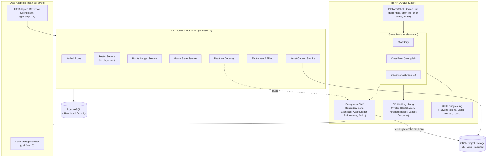

**Đọc sơ đồ:** game chỉ nói chuyện với **SDK**; SDK nói chuyện với **Adapter**; Adapter mới biết backend là gì. Đây là "đường biên" quan trọng nhất của toàn hệ thống.

---

## 3. Tổ chức mã nguồn (Monorepo)

Giai đoạn đầu có thể là 1 app, nhưng **ranh giới thư mục phải đặt như monorepo ngay từ đầu** để sau này tách package không đau.

```text
classcity-ecosystem/
├── apps/
│   ├── hub/                      # Shell: đăng nhập, chọn lớp, launcher các game
│   └── classcity-standalone/     # Chạy ClassCity độc lập (dev & bản bán riêng)
├── packages/
│   ├── shared-types/             # models.ts, event types, manifest types (KHÔNG có logic)
│   ├── ecosystem-sdk/            # ports (interfaces) + EventBus + AssetLoader + Entitlements
│   ├── data-adapters/            # localStorage / http (Spring Boot) adapters
│   ├── three-kit/                # Avatar3D, BlobShadow, Disposer, PerfMonitor, helper Instances
│   ├── ui-kit/                   # Tailwind preset, Modal, Toolbar, Toast
│   └── game-classcity/           # TOÀN BỘ code ClassCity, export { manifest, mount }
│       └── src/ (config, store, components/canvas, components/ui, domain, services)
├── tools/
│   ├── asset-pipeline/           # script tối ưu glb (gltf-transform), sinh hash, sinh manifest
│   └── schema-gen/               # sinh JSON-schema/Zod từ shared-types
└── infra/                        # migrations SQL, RLS policies, CI, IaC
```

**Quy tắc phụ thuộc (kiểm tra bằng ESLint `import/no-restricted-paths` hoặc `dependency-cruiser`):**

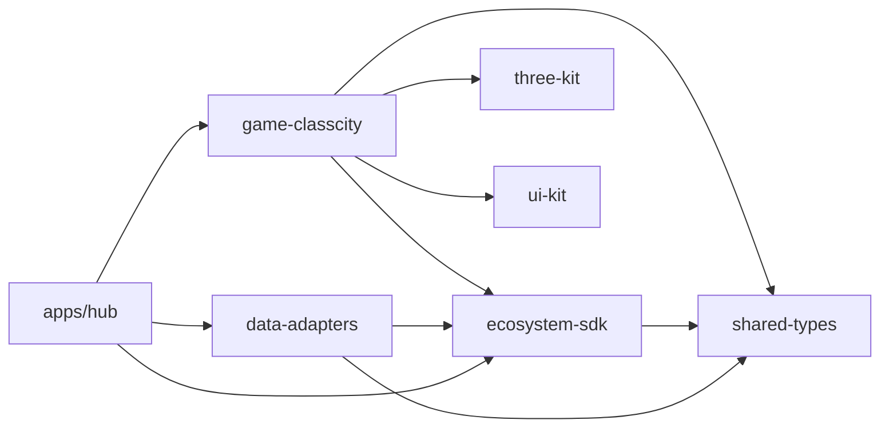
* ❌ `game-*` **không** được import `data-adapters` hay game khác. Adapter được **inject** từ app/hub.
* ❌ `shared-types` không import gì cả.

---

## 4. Hợp đồng tích hợp Game (Game Module Contract)

### 4.1 Game Manifest (tự khai báo)

```ts
interface GameManifest {
  id: GameId;                       // 'classcity'
  name: string;
  version: string;                  // semver
  minSdkVersion: string;            // tương thích SDK
  entry: () => Promise<GameModule>; // dynamic import (code-splitting)
  requires: {
    permissions: Permission[];      // 'roster:read','ledger:write','assets:read'
    entitlements?: Feature[];       // 'classcity.multi_class' (gói pro)
    webgl: boolean;
  };
  assets: { sharedIds: string[]; gamePrefix: string }; // để Hub prefetch
  stateSchemaVersion: number;       // cho migration state riêng
  embedding: 'inline' | 'iframe';   // inline cho game nội bộ, iframe cho bên thứ 3
}
```

### 4.2 Vòng đời Module

```ts
interface GameModule {
  mount(el: HTMLElement, ctx: GameContext): GameHandle;
}
interface GameHandle {
  unmount(): Promise<void>;                 // BẮT BUỘC dispose sạch
  onContextChange?(next: Partial<GameContext>): void; // đổi lớp, đổi âm thanh
}
interface GameContext {
  user: SessionUser;
  classroomId: string;
  repos: RepositoryBundle;     // ports đã inject adapter
  bus: EcosystemEventBus;
  assets: AssetService;
  entitlements: EntitlementService;
  audio: { muted: boolean };
  navigate: { toHub(): void; toGame(id: GameId, params?: object): void };
}
```

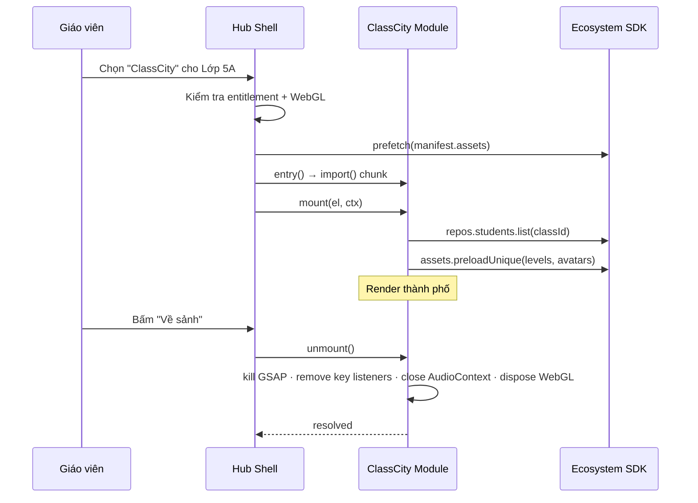

> **Game bên thứ 3 / không tin cậy** → chạy `iframe sandbox`, giao tiếp chỉ qua `postMessage` với schema đã validate (Zod), không truy cập trực tiếp repos.

---

## 5. Kiến trúc dữ liệu

### 5.1 Mô hình quan hệ (ER)

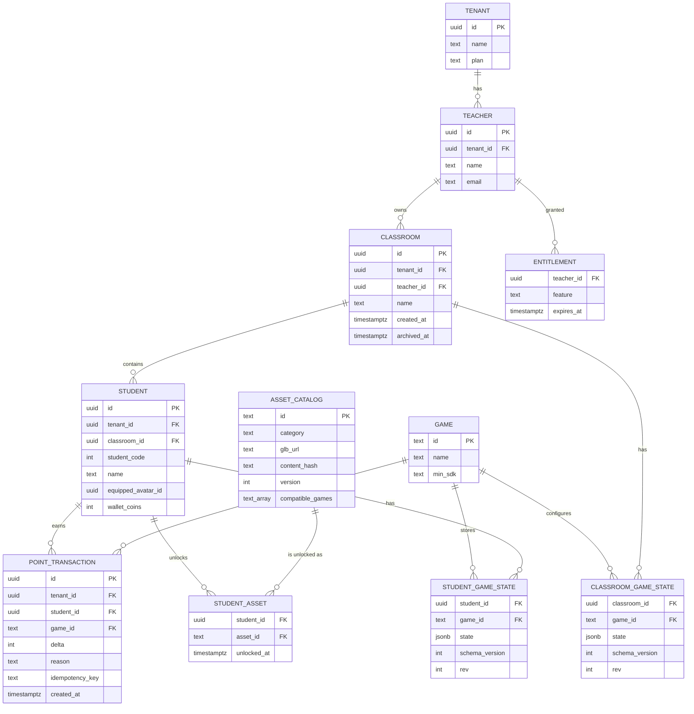

### 5.2 Các quyết định dữ liệu then chốt

1. **Sổ cái điểm (`point_transactions`) là nguồn sự thật duy nhất**
   * `totalPoints` = `SUM(delta)`; lưu thêm cột cache `students.total_points` cập nhật bằng trigger/transaction để đọc nhanh.
   * `idempotency_key` (UUID client tạo) + `UNIQUE(student_id, idempotency_key)` → **gửi lại do mạng lỗi không bị cộng đôi**.
   * Không `UPDATE`/`DELETE` giao dịch; sửa sai = thêm giao dịch bù (`reason: 'revert:<id>'`).
2. **`level` là dữ liệu dẫn xuất**
   * `level = clamp(1, 20, floor(totalPoints / pointsPerLevel) + 1)` với `pointsPerLevel` lấy từ `classroom_game_state` của ClassCity.
   * Hệ quả: giáo viên đổi "5 điểm = 1 level" thì level tính lại tức thì, không cần migrate dữ liệu. Level là *thuộc tính của game*, không phải của platform.
3. **Game state dạng JSONB có version**
   * `schema_version` + `rev` (optimistic concurrency: `UPDATE ... WHERE rev = :rev`).
   * Mỗi game đăng ký `migrate(state, fromVersion) → state` để nâng cấp lazy khi đọc.
4. **Điểm "khoá theo game"**: ledger có `game_id` → báo cáo được "điểm từ ClassArena vs ClassCity"; game có thể cấu hình *hệ số quy đổi* (VD 1 điểm Arena = 0.5 điểm City) ở lớp Domain, không sửa ledger.
5. **Xoá mềm & lưu trữ**: `archived_at` cho lớp (hết học kỳ) – giữ ledger phục vụ bảng xếp hạng cuối kỳ.
6. **Mô hình 3D = metadata trong `asset_catalog`**, file nằm ở CDN. Mở khoá/sở hữu qua `student_assets`. `content_hash` dùng cho cache bất biến (xem §9).

### 5.3 Đa khách hàng (Multi-tenancy)
* Mỗi bảng nghiệp vụ có `tenant_id` (trường/tổ chức). Giáo viên cá nhân = tenant 1 người.
* **PostgreSQL Row Level Security** ép `tenant_id` khớp claim trong JWT (backend đặt `SET LOCAL app.tenant_id` trong mỗi transaction) – kể cả bug ở app cũng không lộ chéo dữ liệu.
* Index tổng hợp: `(tenant_id, classroom_id)`, `(student_id, created_at DESC)` cho ledger.

---

## 6. Tầng truy cập dữ liệu: Ports & Adapters

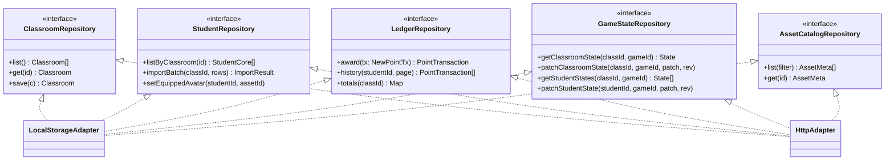

**Ánh xạ vào đặc tả hiện tại:** `src/services/api.ts` trở thành *bộ façade* `createRepositories(adapter)`; hàm cũ như `addStudentPoints()` → `ledger.award()`.

### 6.1 Chuẩn API (khi có backend)

| Nhóm | Endpoint (ví dụ REST) | Ghi chú |
|---|---|---|
| Roster | `GET /v1/classrooms`, `GET /v1/classrooms/:id/students`, `POST /v1/classrooms/:id/students:import` | phân trang, import theo lô |
| Ledger | `POST /v1/ledger` (kèm `Idempotency-Key`), `GET /v1/students/:id/ledger` | trả về `totalPoints` mới |
| Game state | `GET/PATCH /v1/games/:gameId/classrooms/:id/state` | `If-Match: rev` |
| Assets | `GET /v1/assets?category=avatar&game=classcity` | trả `glbUrl` đã gắn hash |
| Entitlement | `GET /v1/me/entitlements` | feature flags theo gói |
| Realtime | `WS /v1/realtime?classroomId=` | kênh `ledger`, `avatar`, `state` |

* Tất cả có `v1` trong path; **không xoá field**, chỉ thêm (additive).
* Lỗi theo chuẩn thống nhất `{ code, message, details, requestId }`.

### 6.2 Chiến lược cập nhật lạc quan + hàng đợi (Outbox)

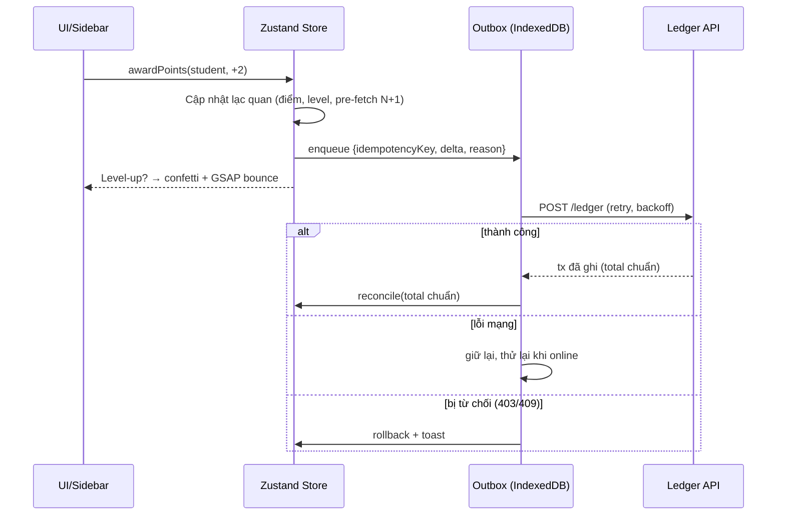

---

## 7. Giao tiếp thời gian thực & liên game

### 7.1 Ba kênh, một giao diện

| Phạm vi | Cơ chế | Dùng khi |
|---|---|---|
| Trong 1 tab (Hub ↔ game inline) | `EventTarget` nội bộ | Hub nhúng ClassCity |
| Nhiều tab cùng máy | `BroadcastChannel('ecosystem')` | GV mở ClassCity ở tab 1, ClassArena ở tab 2 |
| Nhiều thiết bị / học sinh dùng máy riêng | **Realtime Gateway** (WebSocket STOMP hoặc SSE từ Spring Boot) | Học sinh chơi ClassArena trên máy tính bảng, ClassCity cập nhật trên màn chiếu |
| Iframe bên thứ 3 | `postMessage` + validate Zod + kiểm `origin` | Game ngoài |

`EcosystemEventBus` che giấu cả 4 kênh phía sau 1 API: `bus.emit(evt)`, `bus.on(type, handler)`.

### 7.2 Envelope sự kiện (có version, truy vết được)

```ts
interface EcoEvent<T extends string, P> {
  type: T;                 // 'LEDGER:POINTS_AWARDED'
  schemaVersion: 1;
  eventId: string;         // chống xử lý trùng
  occurredAt: string;      // ISO
  source: { gameId: GameId; instanceId: string }; // tránh vòng lặp tự nhận lại
  tenantId: string;
  classroomId: string;
  payload: P;
}
```
* Danh mục sự kiện chuẩn hoá theo *miền* thay vì theo game: `LEDGER:POINTS_AWARDED`, `PROFILE:AVATAR_CHANGED`, `ROSTER:STUDENT_UPDATED`, `CLASSROOM:CHANGED`, `GAME:STUDENT_CALLED`, `HUB:NAVIGATE`, `AUDIO:MUTE_CHANGED`.
* Bên nhận phải **idempotent** (dựa `eventId`) và **bỏ qua** event có `source.instanceId` là chính mình.

### 7.3 Luồng điểm xuyên game

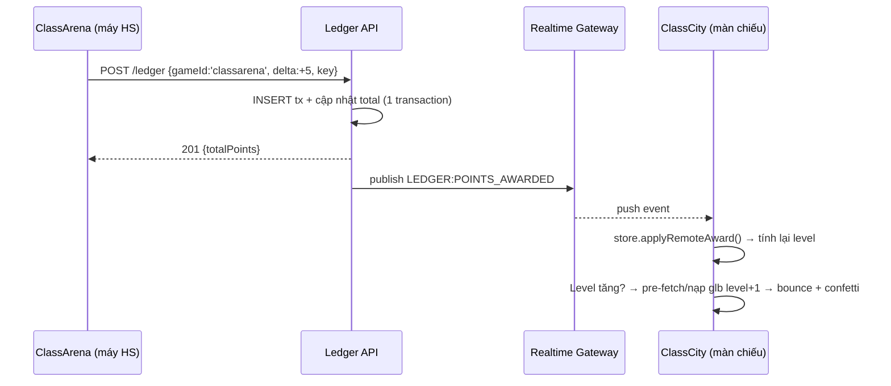

---

## 8. Xác thực, phân quyền & gói dịch vụ

### 8.1 Vai trò
| Vai trò | Quyền chính |
|---|---|
| `teacher` | CRUD lớp mình, cộng/trừ điểm, đổi cấu hình game |
| `student` (tương lai) | Đọc hồ sơ mình, đổi avatar mình đã mở khoá, chơi game được giao |
| `school_admin` | Quản lý giáo viên trong tenant, xem báo cáo |
| `platform_admin` | Quản lý catalog tài nguyên, game, gói |

* JWT chứa `sub`, `tenant_id`, `role`; RLS và API cùng kiểm tra – **không tin client**.
* Giai đoạn 0 (chưa backend): `SessionUser` giả lập giáo viên mặc định; đường code vẫn đi qua `AuthPort` để sau thay thế.

### 8.2 Entitlements (tách gói khỏi code)
* Không viết `if (tier === 'pro')` rải rác. Dùng `entitlements.has('classcity.multi_class')`.
* Bảng `entitlement` ánh xạ gói → danh sách feature; thêm gói mới không sửa game.
* Gợi ý phân gói: *Free*: 1 lớp, 1 game, ≤ 40 học sinh. *Pro*: nhiều lớp, mọi game, xuất báo cáo, avatar/skin cao cấp.

---

## 8A. Mô hình tổ chức đa cấp, danh tính và quyền truy cập

> Mở rộng mục 8. Nếu mâu thuẫn với 8.1, **mục 8A thắng**. Quyết định ngày 07/11/2026: hiện **chỉ giáo viên đăng nhập**; thiết kế phải cho phép sau này **bán cho trung tâm/trường (nhiều cấp, nhiều giáo viên)** và **học sinh cũng đăng nhập**. Đăng nhập làm bằng **Spring Security trước**.

### 8A.1 Cấp bậc tổ chức

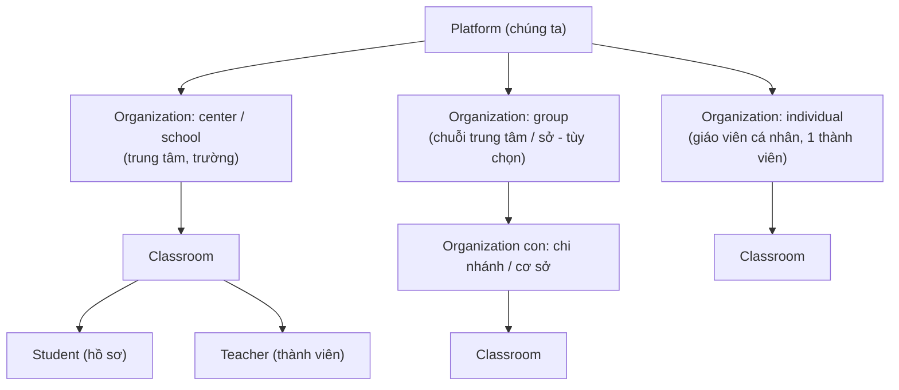

* **`tenant` = `organization`.** Mọi bản ghi nghiệp vụ mang `tenantId` (= id tổ chức), nên cô lập dữ liệu theo tổ chức không đổi so với các mục trước.
* **Giáo viên cá nhân** đăng ký là tự có một tổ chức loại `individual` (1 thành viên, vai trò `org_owner`). Khi trung tâm mua: tạo tổ chức `center`, mời giáo viên; lớp có thể chuyển sang tổ chức mới (`classroom.org_id` đổi, dữ liệu điểm giữ nguyên vì gắn `student_id` ổn định).
* **Cây tổ chức**: `organization.parent_id` (tự tham chiếu), truy vấn cây bằng `ltree` của PostgreSQL. Giới hạn thực dụng 3 cấp (nhóm → cơ sở → lớp). Quyền của quản trị viên ở tổ chức cha **bao trùm** tổ chức con.
* **Gói dịch vụ gắn với tổ chức**: bảng `subscription(org_id, plan, teacher_seats, student_seats, status, period)`. Tổ chức con **kế thừa** gói của tổ chức cha nếu chính sách cho phép. Entitlements (mục 8.2) tính từ gói này.
* Gói dự kiến: `free`, `pro` (cá nhân), `center`, `enterprise`/`school` (theo số ghế giáo viên/học sinh). Bán cho trung tâm Việt Nam thường cần **chuyển khoản + hóa đơn VAT điện tử**, nên giai đoạn đầu cho phép kích hoạt gói **thủ công** từ trang `/admin`, thanh toán trực tuyến làm sau.

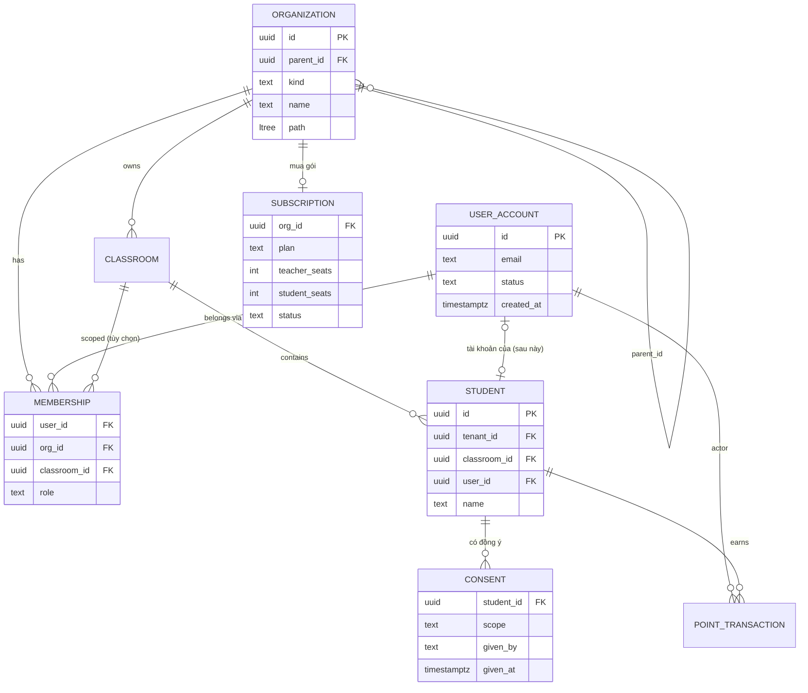
> Sơ đồ này thay phần `TENANT`/`TEACHER` của sơ đồ ER ở mục 5.1: `TEACHER` không còn là bảng riêng, giáo viên là `USER_ACCOUNT` + `MEMBERSHIP` vai trò `teacher`.

### 8A.2 Tách "tài khoản đăng nhập" khỏi "hồ sơ học sinh"
Đây là quyết định quan trọng nhất để mở rộng về sau:
* **`user_account`** = người đăng nhập được (giáo viên, quản trị, sau này học sinh/phụ huynh).
* **`student`** = hồ sơ trong lớp (tên, điểm, avatar, trạng thái game). Hiện **không có tài khoản**; giáo viên thao tác thay.
* `student.user_id` **nullable**: về sau gán tài khoản cho học sinh để các em tự đăng nhập, **không phải đổi dữ liệu điểm/ledger** (vì ledger gắn `student_id`).
* **Ledger ghi `actor_user_id`** (ai cộng điểm): cần cho kiểm tra khi có nhiều giáo viên/trợ giảng; ở G0 là `'local-teacher'`.
* Khi học sinh có thể chuyển lớp hoặc học ở nhiều tổ chức: tách bảng `enrollment(student_id, classroom_id)`; thay đổi này là **bổ sung**, không phá dữ liệu cũ.

### 8A.3 Vai trò, phạm vi và quyền
| Vai trò | Phạm vi | Ví dụ quyền |
|---|---|---|
| `platform_admin` | Toàn nền tảng | quản lý tổ chức, gói, catalog 3D |
| `org_owner` / `org_admin` | Tổ chức (và tổ chức con) | mời giáo viên, quản lý gói, xem báo cáo toàn tổ chức |
| `teacher` | Tổ chức hoặc **một số lớp** | quản lý lớp mình, cộng/trừ điểm, cấu hình game |
| `assistant` (trợ giảng) | Lớp được giao | xem và cộng điểm, không đổi cấu hình/xóa |
| `student` | Chính hồ sơ mình | xem điểm, đổi avatar đã mở, chơi game được giao |
| `guardian` (phụ huynh) | Học sinh được liên kết | chỉ xem |

* **Quyền (`Permission`) là chuỗi** như `roster:read`, `ledger:write`, `class:manage`, `game:configure`, `export:data`, `org:manage`, `billing:manage`. **Bảng ánh xạ vai trò → quyền nằm ở một chỗ duy nhất** (server: một lớp policy; client: `PermissionService`). Không rải `if (role === 'teacher')` trong mã.
* **Bản ghi `membership(user_id, org_id, role, classroom_id?)`**: `classroom_id` rỗng = áp dụng cả tổ chức, có giá trị = chỉ lớp đó.
* **Token chứa phiên đang chọn, không chứa toàn bộ thành viên**: claim `sub` (user), `org` (tổ chức đang dùng), `role`, `kid`. Người thuộc nhiều tổ chức đổi tổ chức bằng `POST /v1/session/switch-org` (cấp token mới).
* **Chống nâng quyền ngang**: mọi truy vấn kiểm `tenant_id` **và** phạm vi lớp (Hibernate filter + RLS làm lớp thứ hai, mục 1A.4.2).
* **Phía client (giai đoạn 0)**: `PermissionService.can('ledger:write')`; adapter localStorage trả "cho phép tất cả" cho giáo viên cục bộ. **UI ẩn hoặc vô hiệu nút theo quyền** (ví dụ vai trò chỉ xem không thấy nút cộng điểm); đây là bước chuẩn bị rẻ nhất cho trợ giảng và học sinh sau này.

### 8A.4 Học sinh đăng nhập (thiết kế sẵn, xây sau)
* **Không dùng email** cho trẻ nhỏ. Hướng đề xuất: **mã lớp + tên đăng nhập + mã PIN**, hoặc **liên kết/QR một lần do giáo viên cấp**; giáo viên đặt lại PIN. Phiên ngắn, quyền rất hẹp.
* **Cùng dạng token** với giáo viên (`sub`, `org`, `role: student`, `kid`), chỉ khác cách xác thực, nên phần còn lại của hệ thống không đổi.
* **Hai chế độ phiên cho game**: `teacher-driven` (hiện tại: giáo viên điều khiển ở màn chiếu) và `student-device` (sau: học sinh chơi trên máy mình, nhận điểm qua kênh realtime `classroom:{id}`). `GameContext.user.role` cho game biết đang ở chế độ nào.
* **Dữ liệu trẻ em**: học sinh dưới độ tuổi quy định cần **sự đồng ý của cha mẹ/người giám hộ hoặc nhà trường**; lưu bản ghi `consent` (ai đồng ý, phạm vi, thời điểm). Việt Nam có Nghị định 13/2023/NĐ-CP về bảo vệ dữ liệu cá nhân (dữ liệu trẻ em là trường hợp được bảo vệ đặc biệt). **Tôi chưa xác minh chi tiết; cần tư vấn pháp lý trước khi bán cho trường/trung tâm.**

### 8A.5 Spring Security cho giai đoạn đầu (cụ thể)
Module `identity` trong `services/api`:
* **Bảng**: `user_account`, `credential` (băm **Argon2id** qua `Argon2PasswordEncoder`), `external_identity` (nhà cung cấp + subject, cho Google), `refresh_token` (lưu **băm**, có `family_id` để xoay vòng và phát hiện dùng lại, `revoked_at`), `email_verification`, `password_reset`, `audit_event` (ai, tổ chức, hành động, đối tượng, IP, thời điểm).
* **Luồng giáo viên**: đăng ký → tự tạo tổ chức `individual` + `membership(org_owner)` → xác minh email → đăng nhập → cấp **access JWT ngắn hạn (~15 phút, ký bất đối xứng, có `kid` để xoay khóa)** + **refresh token xoay vòng** (7–30 ngày).
* **Lưu phiên**: cả hai trong **cookie `httpOnly; Secure; SameSite=Lax` của miền cha**, để Next.js (SSR) và game SPA (tên miền con) cùng dùng; yêu cầu **CSRF token (header tự đặt)** cho mọi request thay đổi dữ liệu. *Cân nhắc lại chi tiết này khi cài đặt, kèm kiểm tra bảo mật.*
* **Gia cố**: giới hạn tốc độ đăng nhập (Bucket4j) + trì hoãn tăng dần, thông báo lỗi chung chung, mật khẩu ≥ 10 ký tự, bắt buộc xác minh email, cấu hình CORS theo danh sách trắng, header bảo mật, `@PreAuthorize` với **mặc định từ chối**, ghi `audit_event`. TOTP (MFA) cho `org_owner`/`org_admin` ở giai đoạn 2.
* **Đổi sang Keycloak sau này không phải viết lại**: server tài nguyên chỉ xác thực JWT theo *hợp đồng claim* (`sub`, `org`, `role`, `kid`). Ban đầu JWT do chính ứng dụng ký (`NimbusJwtEncoder`); khi cần SSO cho trường, đổi cấu hình `issuer-uri` sang Keycloak và giữ nguyên claim. Logic cấp quyền dựa trên `membership` vẫn ở ứng dụng.

### 8A.6 Việc phải làm ngay ở giai đoạn 0 (rẻ, tránh nợ lớn)
1. Kiểu `Role`, `Permission`, `SessionUser { userId, orgId, role, displayName, studentId? }`; `tenantId` = id tổ chức.
2. `PermissionService` (adapter cục bộ cho phép tất cả) và `GameContext.permissions`; UI ẩn nút theo quyền.
3. `PointTransaction.actorUserId`; `StudentCore.userId?` (luôn rỗng ở G0).
4. **Không** mã nào được giả định "chỉ có một giáo viên" hoặc "học sinh không bao giờ có tài khoản".
5. Chưa xây: đăng ký/đăng nhập, tổ chức đa cấp, đăng nhập học sinh, `consent`.

### 8A.7 Hosting backend & PostgreSQL: CHƯA XÁC ĐỊNH
Thiết kế **không phụ thuộc nhà cung cấp** để quyết định muộn:
* Ứng dụng đóng gói **Docker**, cấu hình bằng biến môi trường (12-factor), không gọi API riêng của một đám mây.
* PostgreSQL **chuẩn** (không dùng tính năng độc quyền của nhà cung cấp); lưu file qua **API tương thích S3**; email qua SMTP.
* **Tiêu chí chọn khi cần quyết**: (1) **vị trí lưu dữ liệu** (yêu cầu lưu trong nước của khách hàng trường/trung tâm; cần kiểm tra quy định hiện hành); (2) độ trễ từ Việt Nam; (3) chi phí vận hành và nhân lực quản trị; (4) sao lưu/khôi phục có kiểm thử; (5) khả năng mở rộng khi nhiều lớp dùng đồng thời.
* Các hướng: VPS/đám mây trong nước (dữ liệu tại Việt Nam, tự vận hành nhiều hơn), đám mây quốc tế (managed, dễ mở rộng, cần kiểm tra yêu cầu lưu trữ dữ liệu), hoặc kết hợp. **Quyết định sau, trước khi chạy thử với khách hàng thật.**

## 9. Pipeline & quản lý tài nguyên 3D

### 9.1 Từ file nguồn đến người dùng

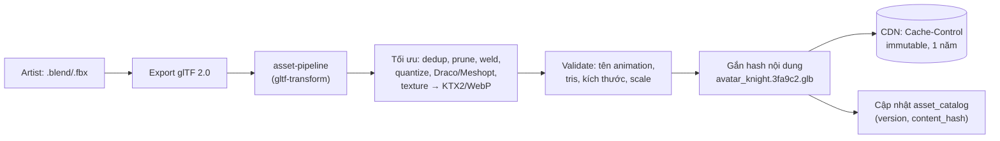

### 9.2 Quy ước bắt buộc cho mô hình (kiểm bằng CI)

| Hạng mục | Quy ước |
|---|---|
| Đơn vị / trục | 1 unit = 1 mét, Y lên, gốc ở **chân** nhân vật / **mặt đất** công trình |
| Avatar | ≤ 3.000 tris, ≤ 1 material, ≤ 512² texture; animation bắt buộc `Idle`, `Walk`, `Jump`, `Cheer` |
| Cửa hàng level 1→20 | tris tăng dần nhưng ≤ 8.000 (level 20); cùng footprint ô đất (VD 6×6) để thay thế không lệch |
| Neo (anchor) | Node rỗng đặt tên chuẩn: `Anchor_Sign`, `Anchor_Topper`, `Anchor_Door` (để gắn biển, topper ngành hàng, điểm đứng) |
| Nén | Meshopt/Draco + KTX2; kích thước avatar ≤ 300 KB, shop ≤ 800 KB |

> Nhờ **Anchor chuẩn**, `shopBranch` topper (bánh kem, cốc cà phê…) gắn được vào cả bản procedural lẫn `.glb` thật mà không sửa logic.

### 9.3 Bộ tải tài nguyên phía client (`AssetService`)

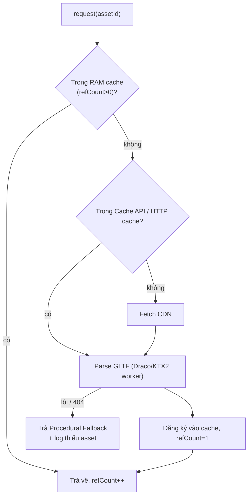

* **Deduplication**: key theo `assetId@contentHash`; nhiều ô đất cùng level dùng chung *Geometry + Material*, chỉ clone `Object3D` (`SkeletonUtils.clone` cho avatar có skeleton).
* **Ưu tiên tải (priority queue)**: (1) cấp độ đang hiện trong lớp → (2) avatar đang hiện → (3) xe → (4) pre-fetch `level+1` (priority thấp, dùng `requestIdleCallback`).
* **Ngân sách đồng thời**: tối đa 3–4 request song song, tránh nghẽn mạng trường.
* **Giải phóng bộ nhớ**: `refCount` về 0 và quá TTL → `geometry.dispose()`, `material.dispose()`, `texture.dispose()`; áp dụng LRU khi vượt ngưỡng RAM (VD 200 MB ước lượng).
* **Chia sẻ giữa game**: cùng `assetId@hash` ⇒ cùng URL ⇒ HTTP cache/Cache API dùng lại khi chuyển game (không cần tải lại).
* **Fallback theo cùng giao diện**: `<ShopModel level branch color>` chọn `Glb` hay `Procedural` bên trong; component cha không biết khác biệt.

---

## 10. Kiến trúc bên trong game ClassCity

### 10.1 Phân tầng trong package `game-classcity`

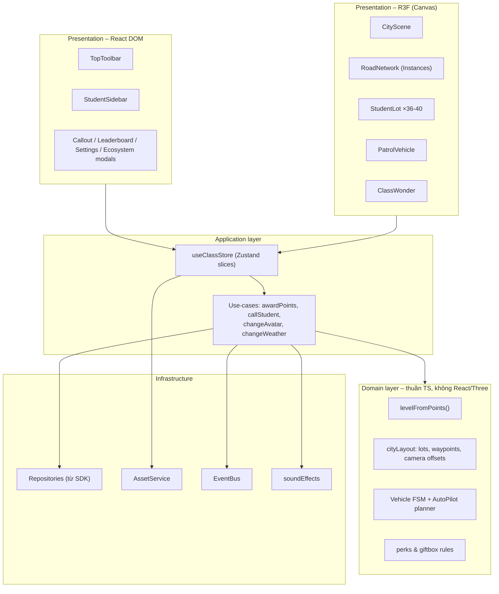

* **Domain thuần TS** ⇒ unit test nhanh, không cần WebGL; có thể tái dùng ở backend (tính lại level/ranking server-side).

### 10.2 Thiết kế Store (Zustand slices)

| Slice | State | Ghi chú |
|---|---|---|
| `sessionSlice` | `user`, `classrooms`, `activeClassroomId` | |
| `rosterSlice` | `studentsById`, `orderedIds`, `selectedId` | dùng `Map`/object theo id, selector hẹp để tránh re-render toàn bộ 40 lô |
| `cityStateSlice` | `pointsPerLevel`, `wonderProgress`, `weatherMode` | |
| `vehicleSlice` | `kind`, `mode: 'idle'|'manual'|'auto'|'stopped'`, `targetLotId` | chỉ lưu *trạng thái rời rạc*, không lưu toạ độ từng frame |
| `uiSlice` | modal đang mở, filter sidebar, `muted` | |
| `assetSlice` | `loadedSet`, `loading`, `errors` | |

* **Quy tắc re-render**: `StudentLot` chỉ subscribe `studentsById[id]` bằng selector + `shallow`. Cộng điểm cho 1 học sinh chỉ render lại 1 lô.
* **Vị trí xe, camera, animation bước chân** nằm ở `useRef` / `useFrame`, **không** vào store (P6).

### 10.3 Máy trạng thái của phương tiện (FSM)

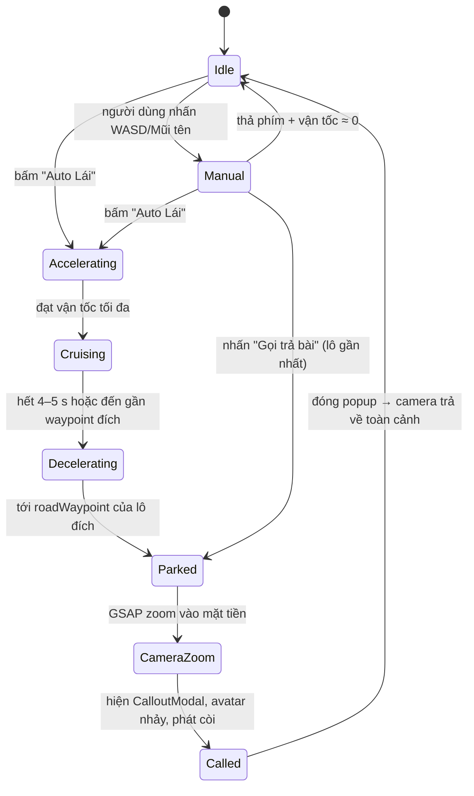
* **Auto-pilot planner (Domain):** chọn lô đích ngẫu nhiên có trọng số (ưu tiên em ít được gọi — dựa lịch sử `GAME:STUDENT_CALLED`), nội suy đường đi dọc đồ thị waypoint với *easing* tăng/giảm tốc, đảm bảo kết thúc đúng `roadWaypoint` của lô.
* **Hộp quà**: va chạm kiểm tra bằng khoảng cách 2D (không dùng physics engine) – đủ rẻ cho máy yếu.

### 10.4 Luồng cộng điểm & lên cấp

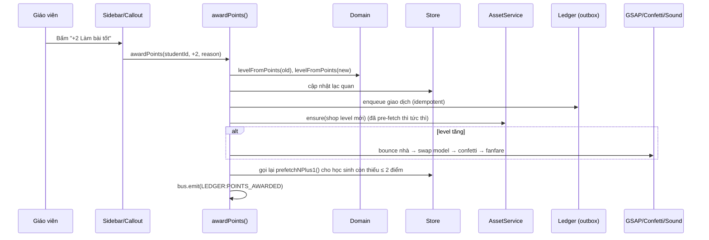

### 10.5 Kiến trúc cảnh 3D & thành phố
* **Layout là dữ liệu, không phải code JSX**: `cityLayout.ts` sinh mảng `Lot { id, position, rotationY, roadWaypoint, parkingHeading, cameraFocus{pos,lookAt} }` từ tham số (số ô, kích thước đường). Thêm layout mới (hình tròn, chữ U) = thêm 1 generator, không đụng component.
* **Camera Controller** là một *state machine nhỏ* (`overview` / `follow-vehicle` / `focus-lot`) bọc GSAP timeline; luôn `kill()` timeline cũ trước khi tạo mới để tránh chồng chéo.
* **Label**: chỉ render `<Html>` đầy đủ cho lô được chọn / gần camera / xe đang đỗ; các lô còn lại dùng nhãn nhẹ (sprite/`<Text>` SDF) hoặc chỉ số thứ tự. Cập nhật LOD theo khoảng cách camera mỗi ~200 ms, không mỗi frame.
* **Thời tiết** là *post-state* của scene: `WeatherController` điều chỉnh ánh sáng/sương/skybox + `Points` cho mưa (1 draw call) + `Rainbow` mesh; không tạo lại lô.

---

## 11. Ngân sách hiệu năng (Performance Budget)

| Chỉ số | Mục tiêu (iGPU văn phòng) | Cách giữ |
|---|---|---|
| FPS | ≥ 60 (không dưới 30) | `PerformanceMonitor` của drei |
| Draw calls | ≤ 150 | Instances (cây/đèn/vạch), gộp material |
| Tam giác trên màn hình | ≤ 400k | LOD theo level, avatar ≤ 3k |
| Texture RAM | ≤ 150 MB | KTX2, atlas, giải phóng LRU |
| JS ban đầu (Hub) | ≤ 300 KB gzip | code-split game bằng `import()` |
| Thời gian tới tương tác | ≤ 3 s trên mạng trường 10 Mbps | prefetch chọn lọc, fallback procedural |
| Dung lượng glb tải ban đầu | ≤ ~5 MB | chỉ tải *unique levels/avatars* đang dùng |

**Suy giảm thích ứng (Adaptive Quality):** `PerformanceMonitor` hạ dần theo bậc: `dpr 1.5 → 1` → tắt mưa dạng hạt dày → giảm số Html label → tắt bóng đổ của công trình (giữ blob shadow) → tắt post-processing. Hồi phục khi FPS ổn định. Cho phép giáo viên ép "Chế độ tiết kiệm" thủ công.

* `frameloop="demand"` khi thành phố tĩnh (không xe chạy, không thời tiết) rồi `invalidate()` khi có thay đổi – tiết kiệm pin/laptop. Khi có animation (avatar đi dạo) chuyển sang `always`.

---

## 12. Offline & độ bền

* **PWA**: Service Worker cache shell + model *đã dùng*; lớp học vẫn chạy khi mất mạng.
* **Outbox** (§6.2) lưu giao dịch ở IndexedDB, đồng bộ khi online, hiển thị chỉ báo "Chưa đồng bộ: n".
* **Xung đột**: ledger không xung đột (chỉ cộng dồn); `game_state` dùng `rev` + merge cấp field (last-writer-wins có cảnh báo).
* **Sao lưu**: `exportEcosystemBackupJSON()` kèm `schemaVersion`; `import` chạy migration + validate Zod trước khi ghi.
* **Phục hồi lỗi WebGL**: lắng nghe `webglcontextlost` → hiện thông báo + tự khởi tạo lại; nếu WebGL không có → *Chế độ 2D danh sách* (Sidebar vẫn dùng được để cộng điểm).
* **Error Boundary** bao `<Canvas>` và từng `StudentLot` (một mô hình lỗi không làm sập thành phố).

---

## 13. Bảo mật & quyền riêng tư (dữ liệu trẻ em)

* **Tối thiểu hoá dữ liệu**: chỉ lưu tên/biệt danh + mã số; không lưu ảnh, địa chỉ, ngày sinh. Hỗ trợ *biệt danh/tên rút gọn* hiển thị trên màn chiếu.
* RLS theo tenant (§5.3); mọi truy vấn qua JWT; khoá service chỉ ở server.
* **Validate mọi biên**: Zod schema cho import CSV/JSON, cho event `postMessage`, cho body API.
* **Iframe sandbox** + CSP chặt (`script-src` chỉ domain tin cậy); kiểm `event.origin`.
* **Rate-limit** `POST /ledger` theo giáo viên/lớp; giới hạn `|delta|` hợp lý; ghi `actor` (ai cộng) để audit.
* **Tuân thủ**: quyền xoá/xuất dữ liệu học sinh; nhật ký truy cập; lưu trữ theo khu vực nếu trường yêu cầu.
* Nhập CSV: chống CSV/Formula injection khi xuất báo cáo (`=`, `+`, `@` đầu ô).

---

## 14. Quan sát, kiểm thử & vận hành

### 14.1 Kim tự tháp kiểm thử
| Tầng | Công cụ gợi ý | Nội dung |
|---|---|---|
| Unit (Domain) | Vitest | `levelFromPoints`, auto-pilot planner, layout generator, migration state |
| Contract | Vitest + Zod | Mọi adapter phải qua **cùng bộ test** của interface Repository (LocalStorage ≡ HttpAdapter) |
| Component | Testing Library | Sidebar, Toolbar, Modal |
| Scene logic | Vitest + `@react-three/test-renderer` | Lô render đúng model theo level, dispose khi unmount |
| E2E | Playwright | Auto lái → dừng → popup → cộng điểm → lên cấp |
| Hiệu năng | Playwright + `performance`/`stats` | Gác FPS/draw call (`renderer.info`) trong CI bằng ngưỡng |
| Asset CI | `gltf-validator` + script | Tris, kích thước, tên animation, anchor |

### 14.2 Quan sát
* Telemetry ẩn danh: FPS trung bình, thời gian tải asset, lỗi tải glb (thiếu → báo để bổ sung), tỉ lệ dùng fallback, cờ thiết bị yếu.
* Sentry (hoặc tương tự) cho lỗi JS + `webglcontextlost`; gắn `requestId`, `gameId`, `sdkVersion`.

### 14.3 Môi trường & phát hành
* `dev` (localStorage + mock) → `staging` (backend thật, dữ liệu giả) → `prod`.
* **Feature flags** cho game/tính năng mới; **canary** theo tenant.
* Versioning: SDK theo semver; Hub kiểm `minSdkVersion` của manifest, game cũ vẫn chạy nhờ *additive-only*.
* CI: lint (kèm luật phụ thuộc §3) → type-check → unit → build → asset-validate → E2E → deploy preview.

---

## 15. Lộ trình triển khai theo giai đoạn

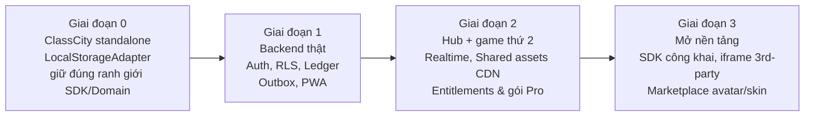

| Giai đoạn | Việc phải có | "Cửa kiểm" hoàn thành |
|---|---|---|
| **0** | Cấu trúc thư mục/phụ thuộc như §3 (có thể 1 repo, nhiều thư mục); ports §6; Domain thuần; EventBus nội bộ; Asset loader + fallback | Chạy được toàn bộ đặc tả; đổi adapter giả (in-memory) trong test mà game không đổi 1 dòng |
| **1** | Postgres + RLS; HttpAdapter; Ledger idempotent; Outbox | Cùng bộ contract test pass cho cả 2 adapter |
| **2** | `apps/hub`; game thứ hai tối thiểu (VD *ClassArena* chỉ trả lời nhanh để phát điểm); BroadcastChannel/Realtime; CDN assets chung | Điểm từ game 2 làm nhà ở ClassCity lên cấp *không reload* |
| **3** | Tài liệu SDK; sandbox iframe; quy trình duyệt asset | Một game bên ngoài tích hợp chỉ bằng manifest |

---

## 16. Nhật ký quyết định kiến trúc (ADR) & rủi ro

| ADR | Quyết định | Lý do | Đánh đổi |
|---|---|---|---|
| 01 | Monorepo + package ranh giới rõ | Dùng chung SDK/types, tách game sạch | Setup ban đầu phức tạp hơn (dùng pnpm workspaces + Turborepo) |
| 02 | Ledger append-only, level dẫn xuất | Chống mất/đôi điểm, đổi luật không migrate | Cần cột cache + trigger để đọc nhanh |
| 03 | JSONB state có `schema_version`/`rev` | Mỗi game tự do mở rộng, không đổi schema chung | Khó truy vấn chéo bằng SQL thuần |
| 04 | Ports & Adapters | Đổi backend không đụng game | Thêm lớp trừu tượng; cần contract test |
| 05 | Game = module inline lazy-load; bên ngoài = iframe | Hiệu năng cho game nội bộ, an toàn cho bên thứ 3 | Hai đường tích hợp cần duy trì |
| 06 | Asset URL gắn content-hash, `immutable` | Cache vĩnh viễn, chia sẻ giữa game | Cần bước build/publish asset |
| 07 | Render state ngoài React | Giữ 60 FPS trên iGPU | Phải kỷ luật khi code (review checklist) |
| 08 | Offline-first + Outbox | Mạng trường thất thường | Phức tạp reconcile; cần UI chỉ báo đồng bộ |
| 09 | `tenant` = `organization`, cây tổ chức (`parent_id`, `ltree`) | Bán cho trung tâm/chuỗi mà không đổi mô hình dữ liệu | Truy vấn cây phức tạp hơn; giới hạn 3 cấp |
| 10 | Tách `user_account` khỏi `student`; `student.user_id` nullable | Học sinh đăng nhập sau không phải đổi dữ liệu điểm | Thêm quan hệ ngay từ đầu |
| 11 | Spring Security tự làm, hợp đồng claim ổn định (`sub`, `org`, `role`, `kid`); đổi sang Keycloak bằng `issuer-uri` | Giảm vận hành giai đoạn đầu | Tự chịu trách nhiệm bảo mật xác thực; cần review bảo mật |
| 12 | Hosting trung lập nhà cung cấp (Docker, 12-factor, Postgres/S3 chuẩn) | Quyết định muộn, không bị khóa nhà cung cấp | Không dùng được dịch vụ độc quyền |

**Rủi ro chính & giảm thiểu**
1. *Thiếu asset .glb thật ban đầu* → Procedural Fallback dùng **cùng giao diện & Anchor** như bản glb.
2. *Máy yếu hơn dự kiến* → Adaptive Quality + chế độ tiết kiệm + chế độ 2D.
3. *Schema event/state thay đổi gây vỡ game cũ* → additive-only, `schemaVersion`, contract test.
4. *Phình to bundle khi thêm game* → code-split theo manifest, đo ngân sách JS trong CI.
5. *Dữ liệu trẻ em* → tối thiểu hoá, RLS, audit log, hỗ trợ ẩn danh/biệt danh.

---

### Quyết định đã chốt và việc còn mở

**Đã chốt (07/11/2026):**
* Backend **Java Spring Boot + PostgreSQL**; web **Next.js**; game/Hub **Vite SPA** (mục 1A.4).
* Đăng nhập: **Spring Security trước**, giữ đường nâng cấp Keycloak (mục 8A.5).
* Hiện **chỉ giáo viên đăng nhập**, nhưng thiết kế **đa cấp** (trung tâm/trường) và **học sinh đăng nhập về sau** (mục 8A).
* Giai đoạn 0: 1 app Vite, thư mục chia ranh giới như monorepo; tách package khi có game thứ hai.

**Còn mở:**
1. Hosting backend và PostgreSQL (mục 8A.7): chưa xác định.
2. Kiểm tra pháp lý dữ liệu trẻ em và yêu cầu lưu trữ dữ liệu trong nước trước khi bán (mục 8A.4, 8A.7).
3. Thời điểm làm đăng nhập học sinh và cổng phụ huynh.
4. Nhà cung cấp thanh toán trực tuyến ở Việt Nam (PayOS, VNPay hay MoMo).
5. PostgreSQL managed hay tự host.
